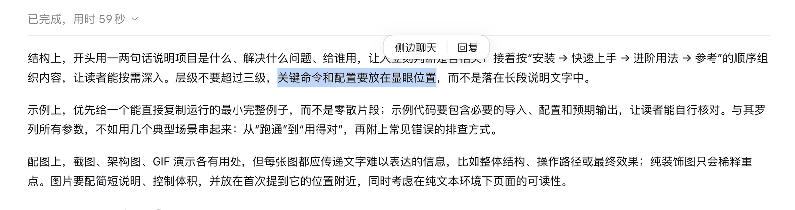
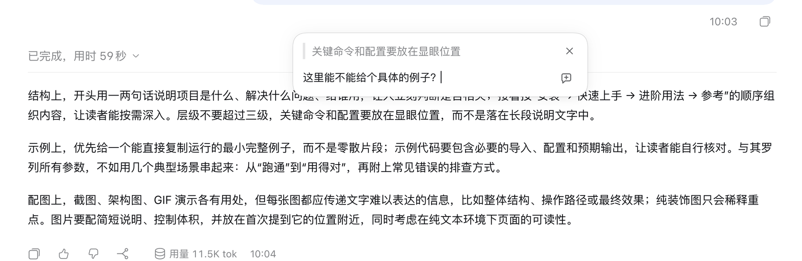
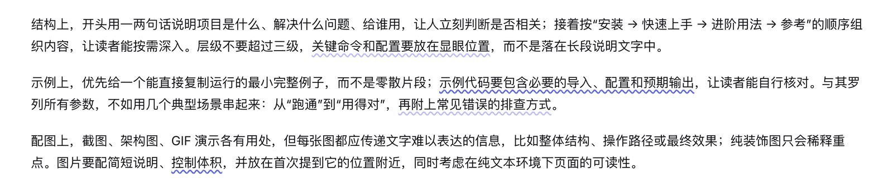
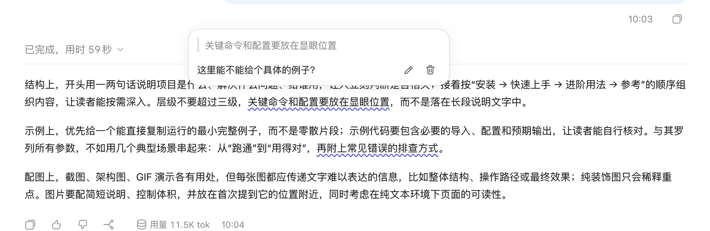
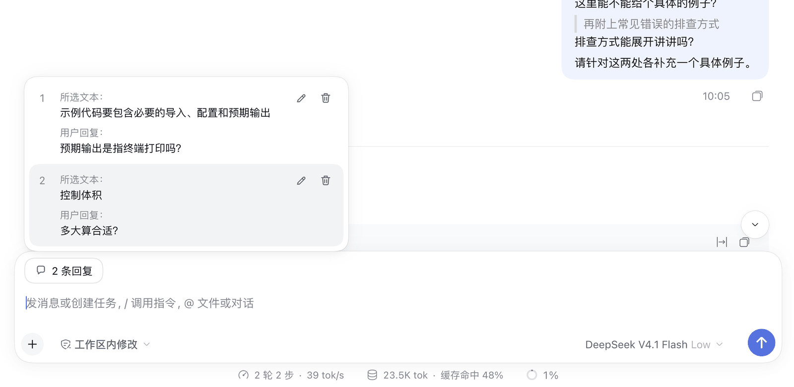
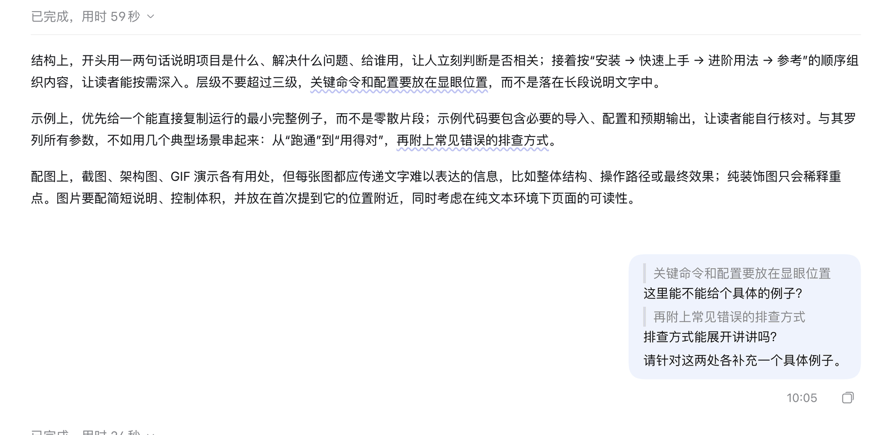
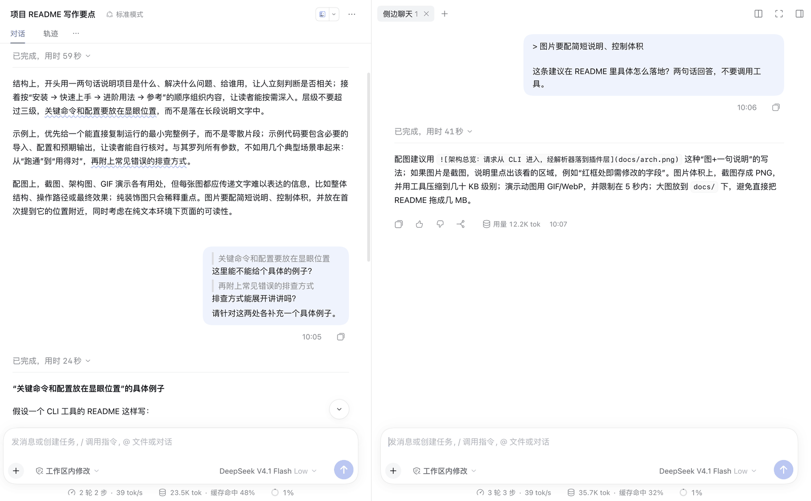

# dsh-plugin-reply-and-side-chat

DeepSeek Harness（dsh）Web 端插件，给对话加上两个常用动作：

- **选中回复**：选中对话里的一段文字，针对它写一条评论；可以一次引用多段，和正文一起发给模型。
- **侧边聊天**：在右侧栏开一个临时对话，它带着当前会话的全部上下文，但不往主会话里写任何东西。

交互参考 Claude Desktop 的 Reply 与 Side chat。

适用版本：dsh 0.2.1-rc.5（`dsh web`）。

## 安装

npm 包名：`dsh-plugin-reply-and-side-chat`。在 dsh Web 的「插件」页安装并启用后即可使用，无需额外配置。

## 使用

### 1. 选中文字，出现工具条

在用户消息、模型回复或思考正文里拖选一段文字，松开鼠标后，选区上方会出现「侧边聊天 ｜ 回复」工具条，位置靠近鼠标松开的一侧。

- 点击工具条外、按 Esc、清空选区或切换会话，工具条消失。
- 选区里带上「已完成，用时」、工具调用行、时间等界面元素时不会出现工具条，输入框和侧栏里的选区同样不触发。

### 2. 回复：对选中的文字写评论

点「回复」，工具条放大成回复浮窗：上半部分是原文摘录，下半部分是输入框。

- Enter 或右侧按钮添加，Shift+Enter 换行，`×` 放弃。
- 回复可以留空，此时只引用原文。
- 已输入内容时点浮窗外不会关闭，浮窗抖一下提醒先保存或关闭，避免误触丢失；Esc 则直接关闭。

### 3. 波浪线：看到哪些文字被引用了

添加后，原文下会画一条蓝色波浪线。点击波浪线打开「查看」浮窗，可以编辑或删除这条回复。

- 深色波浪线是待发送的回复；浅色是已经随消息发出的引用，用来对照。
- 两条回复的原文重叠时会拆开画，相邻的两段颜色深浅交替，点击哪一段就打开哪一条。

### 4. 回复汇总条：集中管理待发送的回复

已添加的回复不会在输入框上方堆成一排卡片，而是收成输入卡片里的一个「X 条回复」小条。悬停它，向上展开详情列表：

- 铅笔：跳回原文位置并直接进入编辑。
- 垃圾桶：删除这一条（悬停变红）。
- 汇总条右侧的 `×`：一次删除全部回复。
- 回复属于当前会话的草稿：切换会话再切回来还在，发送成功后清空，发送失败时保留。
- 引用在输入框里是隐藏的，退格、Delete、按词或按行删除都不会误删它，只能通过上面这些按钮删除。

### 5. 发送：引用随消息一起发出

照常输入正文并发送。所有引用和正文合并成一条用户消息，气泡里每条引用显示为灰色带竖线的原文，下面是你的回复。正文可以为空，此时只发引用。

点击气泡里的引用原文，对话会滚动到被引用的位置。

### 6. 侧边聊天：不打断主会话的追问

三种方式打开侧边聊天：

1. 选中文字后点工具条上的「侧边聊天」，输入框会预填 `> 选中的原文`。
2. 右侧栏的「开始」页，点「侧边聊天」卡片，打开一个空的侧边聊天。
3. 已打开的侧边聊天 tab 条上点「+」，再选「侧边聊天」。

- 第一次发送时才会从主会话分叉，分叉点是主会话最近一个已完成的回合；发送之前不创建任何会话，关掉没发过的 tab 不留痕迹。
- 侧边聊天与主会话使用同一工作区、模型和 agent preset，模型拥有完整上下文；tab 里只显示分叉之后的消息。
- 侧边聊天里的任何消息都不会进入主会话。
- 可以同时开多个，标题按当前打开的顺序编号为「侧边聊天 1、2、3…」。
- 在侧边聊天里同样可以选中回复；在其中再点「侧边聊天」，新的侧边聊天仍以主会话为源。
- 分叉出来的会话不会出现在左侧会话列表里。关闭 tab 时自动归档；`dsh web` 重启后，残留的分叉会话在插件启动时归档。刷新网页不会丢失侧边聊天。

## 特色

- **多段引用一次发出**：一条消息里可以带多段原文，每段各有自己的评论。
- **原文始终可见**：波浪线直接画在原文上，不用在输入框上方翻卡片；重叠、交叉的引用也能分段区分。
- **草稿不丢**：回复跟着会话走，误触、切换会话、发送失败都不会丢。
- **侧边聊天零污染**：只读继承上下文，主会话没有任何新增消息，也不留在会话列表里。
- **贴合宿主外观**：只用宿主主题变量，亮色和暗色主题都正常；界面文案提供中文和英文；插件停用后浮层和监听全部移除。

## 已知限制

- 选区只在主对话区和侧边聊天里生效，子代理侧栏等其他区域不触发。
- 波浪线和气泡跳转靠文本匹配定位：同一回合里有多处相同文字时取最近的一处，原文被改写或分页收起时找不到，不影响回复本身。
- 部分样式依赖宿主的 DOM 属性和类名（如 `data-composer-card`、`data-chat-turn`），dsh 升级后可能需要适配。
- 归档不是删除：分叉会话会留在「已归档」里和磁盘上。

完整的需求和验证记录见 [REQUIREMENTS.md](REQUIREMENTS.md)。

## 开发与同步

本仓库同时以 git subtree 的形式存放在 [my-dsh-plugin](https://github.com/fenton-xue/my-dsh-plugin) 的 `plugins/reply-and-side-chat/` 下，两边通过该仓库的 `tools/sync-plugin.sh push|pull` 同步。
